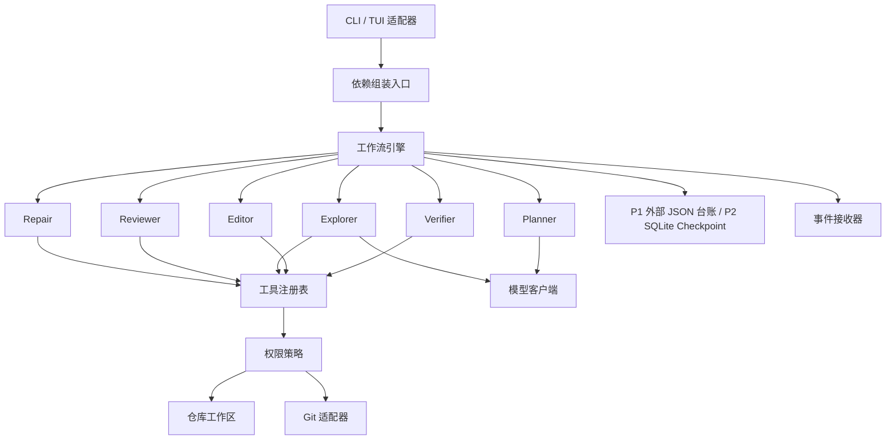

# 架构设计

## 产品边界

RepoPilot 是面向本地 Git 仓库的任务运行时，而不是通用桌面助手。每次运行只对应一个仓库和
一个任务。所有读取、编辑、命令、审批、状态转换和验证结果都归属于本次运行，后续可以保存为
checkpoint 并接受审计。

## 分层结构



| 分层 | 负责内容 | 不应负责 |
|---|---|---|
| CLI | 参数解析和结果展示 | 工作流编排决策 |
| TUI | 交互式命令分发与渲染 | 绕过审批或直接写文件 |
| Workflow | 阶段转换、预算和重试限制 | 子进程或文件 I/O |
| Reviewer | 只读审查与 finding 归因 | 修改文件或 diff |
| Tools | 单项具体能力 | 权限决策 |
| Policy | `allow/ask/deny` 策略 | 具体能力实现 |
| Workspace | 仓库路径与文件边界 | 模型逻辑 |
| Model client | 模型提供方的请求和响应适配 | Shell 或文件访问 |
| Provider registry | 按名称解析 Provider、凭据和默认值 | 具体请求逻辑 |
| Store | 序列化的运行状态 | 隐藏的内存状态 |
| Events | 可观测的事实记录 | 控制工作流 |

## 状态模型

`RunState` 是工作流节点与持久化层之间的契约。它始终保持 JSON 兼容，因此后续可以在不修改 CLI
和工具契约的情况下，把当前显式状态机接入 LangGraph 和 SQLite。

```text
CREATED
  -> DISCOVER
  -> PLAN
  -> WAIT_APPROVAL
  -> PATCH
  -> VERIFY
       -> REPAIR -> VERIFY
       -> REVIEW
  -> DONE
```

终止阶段包括 `DONE`、`FAILED` 和 `CANCELLED`。重试预算必须由代码字段控制，不能只依赖提示词约束。

## 安全不变量

1. 所有路径都必须解析到探测出的 Git 根目录之下。
2. 工具执行前必须拒绝访问疑似密钥文件和 Git 内部文件。
3. 模型只能选择结构化工具，默认不能获得原始 Shell。
4. 命令以 argv 数组执行，不使用 `shell=True`。
5. 验证动作只能来自代码内置白名单，模型不能提供 argv 或环境变量。
6. 默认策略下，编辑文件和运行验证命令都需要审批。
7. 即使配置了宽泛的 Git 写权限，破坏性 Git 操作仍然必须被拒绝。
8. P1 开始编辑文件前，必须记录本次运行开始时已经存在的用户改动。
9. 补丁触及已修改或未跟踪文件时必须整体拒绝，提案之后的并发修改也必须导致冲突。
10. 补丁台账位于目标仓库之外，不得包含 API Key；撤销前必须核对应用后的文件 hash。
11. 验证结果逐动作落盘；验证失败的任务不得进入 `DONE`。
12. 修复补丁只能修改原始提案已覆盖的文件，且总次数受配置预算限制。
13. 审查节点只读，且其结论必须引用补丁涉及的文件；审查不改变已应用的代码。
14. 凭据只从环境变量读取，不写入配置对象、检查点、报告或日志；插件不得覆盖内置 Provider。
15. 并行只用于只读操作与独立验证子进程；结果一律按输入顺序归并，异常按输入顺序回传。
16. Git 提交默认被策略拒绝；启用后也只提交本次运行的文件，且要求处于 `DONE` 阶段并与应用回执一致。永不自动提交，永不 `push`。
17. 沙箱前缀只能来自配置的 argv，永不经过 shell，动作参数只能追加；CI 模式永不 apply 或 push。
18. 沙箱协议只传输动作名；服务端自行解析 argv，客户端的命令字段一律忽略。非回环绑定必须配置 token。
19. 沙箱租户之间不共享工作区、白名单与 token；并发由全局与每租户信号量限制，超限返回 `busy`。TLS 最低 1.2。
20. Docker 后端每次动作启动一次性容器（`--rm`），工作区挂载到 `/work`；配置值逐项校验，不得以 `-` 开头；超时必须终止容器。
21. 容器池中的每个动作仍独占一个容器：用后销毁并在后台补充，动作之间不共享容器内状态。
22. 沙箱审计只记录租户、动作名、结果、退出码、耗时与客户端地址，不得写入 token 或命令输出；配额计数与审计共用同一 SQLite 文件并跨重启生效。
23. RSI 的"跑"与"判"必须分离：候选进程只产出原始事实，打分只由 `grader.py` 完成；评分规则是代码常量，候选补丁不得触碰 grader/benchmark，指纹不一致即拒绝评分，候选补丁永不自动应用。
24. 多轮 RSI 的每轮候选都必须独立评测并追加到只增历史；重复补丁按 sha256 去重，任何一轮都不会自动应用补丁。

## 实施状态与扩展顺序

- P0（已完成）：实现 `search_code`、仓库清单、DeepSeek 模型适配器、Explorer 和 Planner。
- P1（已完成）：实现 unified diff 校验、仓库外补丁台账、人工审批和精确撤销。
- P2（已完成）：实现验证白名单、argv 执行器、VERIFY/REPAIR 闭环和 SQLite checkpoint 恢复。
- P3（已完成）：实现限定范围的单次修复、Repo Map、只读审查节点、运行报告和离线基准。
- P4（已完成）：实现 Provider 注册表、entry point 插件发现和 `providers` 命令。
- P5（已完成）：实现标准库交互式 TUI，命令与 CLI 共享同一套服务层。
- P6（已完成）：实现有界并行只读探索与独立验证执行。
- P7（已完成）：实现默认关闭、单独审批、只提交运行文件的 Git 提交。
- P8（已完成）：实现可插拔沙箱后端与无交互 CI 入口。
- P9（已完成）：实现独立沙箱服务与动作名协议。
- P10（已完成）：实现沙箱 TLS 与多租户调度。
- P11（已完成）：实现 Docker 一次性容器后端。
- P12（已完成）：实现容器池与镜像预热。
- P13（已完成）：实现沙箱请求审计与配额持久化。
- P14（已完成）：实现人审批的自我改进评测与范围守卫。
- P15（已完成）：实现多轮 RSI 与只增历史 scorecard。
- 后续：IDE 集成、RSI 历史可视化。
